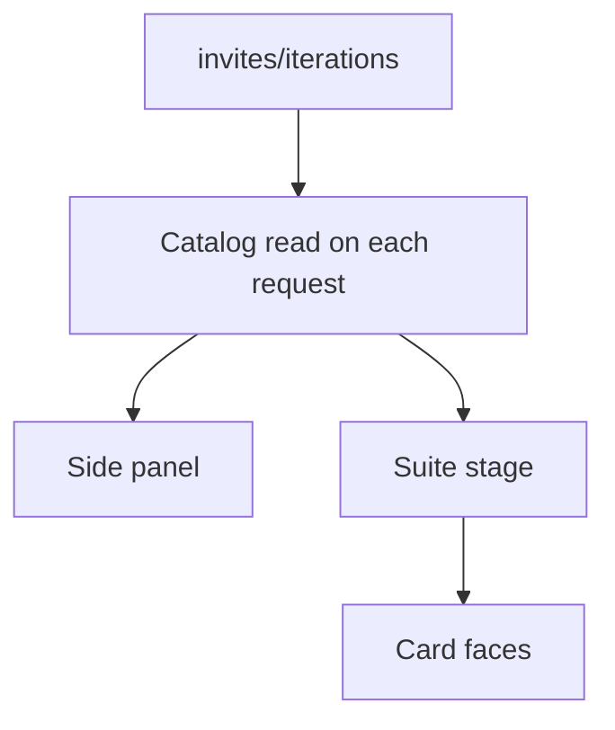
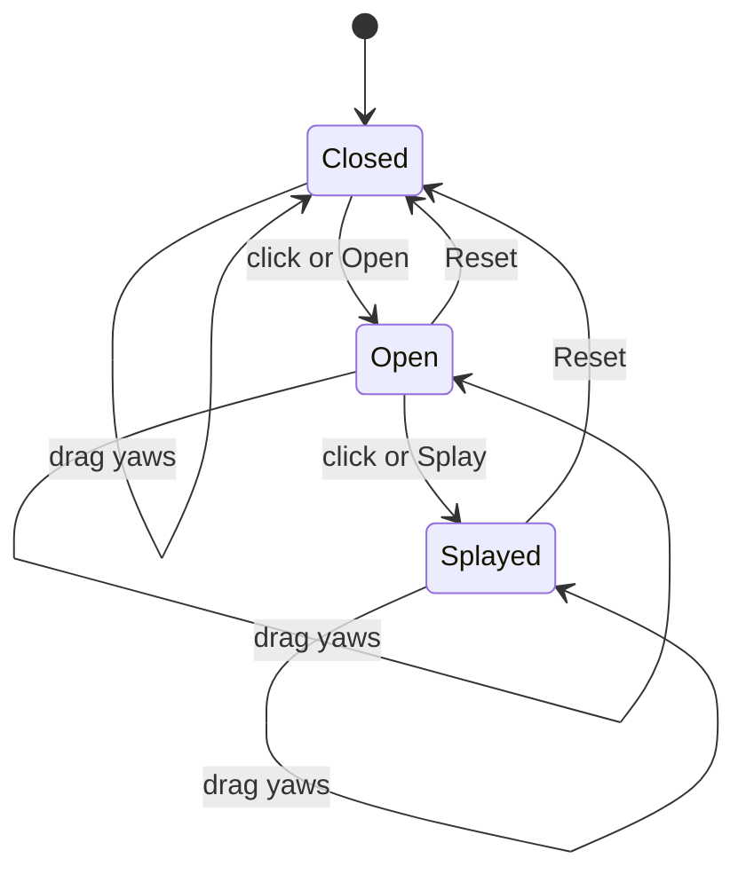

# Invite Studio - Plan

## Goal Capsule

- **Objective:** A reviewer can open the local studio, pick any saved invitation, take it from a closed suite to splayed inner cards, turn it, and put it back, and a later session can add another invitation by adding a folder.
- **Means:** A Next.js page whose project root is `invites/`, reading one directory per iteration and presenting it as a CSS hinge rig (KTD1, KTD2).
- **Authority:** Product behavior lives on the requirements. Mechanism lives on the key technical decisions. A unit does not override either.
- **Execution profile:** Code. Prove the catalog with unit tests. Prove the pose in a browser. The hinge rig is not done on angle math alone.
- **Stop conditions:** Stop if the work starts sending mail, collecting guests, encoding a personal delegate link, writing pose or placeholder files, or adding a WebGL scene.
- **Finishes the work:** The implementing session builds the studio inside `invites/`. The review team uses it locally.

---

## Product Contract

### Summary

A local page for NC27 invitation brainstorming. The side panel lists every complete iteration saved under `invites/`. The main view opens the selected suite, splays its inner cards, turns the suite, and resets that pose. Assets, a moodboard, and notes stay in the same folder so a later session can continue from the files.

### Problem Frame

NC27 needs a way for the review team to look at invitation ideas together before anything is printed or sent. The physical reference is a kankotri-style suite: a closed paper construction, a belly band or equivalent, and one to three inner cards such as a letter, a code, and theme art. Flat images do not show how the suite opens. The repo currently has no application, so this studio has to carry its own explanation. A later session on another machine, with no prior chat, has to be able to read `invites/` and add another iteration.

### Key Decisions

- **A kankotri and an invite are the same paper suite.** (session-settled: user-approved — chosen over treating the spoken name as a different tradition.) Governs R1.
- **The side panel is an open list of saved iterations.** (session-settled: user-directed — chosen over four locked constructions.) Governs R2.
- **The studio is for team brainstorming.** (session-settled: user-approved — chosen over a personal link for delegates.) Governs R3.
- **The first studio includes starter iterations so the flow can be tried.** (session-settled: user-approved — chosen over an empty catalog.) Governs R4.

### Requirements

**Language and audience**

- R1. The page and the notes use one meaning: a kankotri and an invite are the same paper invitation suite.
- R2. The side panel lists every complete iteration and no fixed count of them. It does not list `invites/assets/`, `invites/moodboard/`, or `invites/notes/`.
- R3. The page is a local review tool. It does not create guest accounts, send mail, or encode a personal link for a delegate.

**What ships in the folder**

- R4. The first studio includes one starter iteration for each construction the page can open: `french-door`, `envelope`, `booklet`, and `belly-band`. Across that set, one card omits its image, one `qr` card has an `https` URL, one `qr` card has no URL, and every `letter` card has text.
- R5. A complete iteration has one to three inner cards, and each card's role is unique among `letter`, `qr`, and `theme`.

**Card faces**

- R6. A `letter` card with text and no image shows that text in the page.
- R7. A `qr` card with an `http` or `https` URL and no usable image shows a generated code that is not a link.
- R8. A card with no usable image and no generated code shows a stand-in labeled `Letter`, `QR`, `Theme`, or `No URL` when the card is a `qr` card without a URL. The page does not write that stand-in to disk.
- R19. A usable image is the face of its card. When the card is a `letter`, its text is the image's alternative text.

**Looking at a suite**

- R9. When the address has no selected id and at least one complete iteration exists, the page selects the first in title order.
- R10. When no complete iteration exists, the panel is empty and the stage says that no complete iteration is available.
- R11. The selected suite starts closed, front-facing, and still.
- R12. A click with negligible movement steps the suite from closed to open, then from open to splayed, and a further click does not change the hinge pose.
- R13. Pointer drag yaws the suite around the vertical axis in any hinge pose. Movement past the drag threshold does not count as the click in R12.
- R14. Reset returns the selected suite to closed and front-facing, and it does not write files.
- R15. Open, splay, rotate, and reset are also buttons. Nothing starts moving on its own. Under reduced motion, pose changes snap.
- R16. The side panel starts expanded. Collapsing it lasts for that page session only.

**Changing the catalog**

- R17. A new iteration is a new directory. The page does not create directories and does not write images.
- R18. A new directory or a replaced image appears on the next page load. The open page does not poll.

### Actors

- A1. A review-team member uses the page in a local meeting.
- A2. A person, or a later agent with no prior chat, adds or replaces files under `invites/`.

### Key Flows

- F1. Review a suite
  - **Trigger:** A1 opens the local page.
  - **Actors:** A1
  - **Steps:** The page selects a complete iteration (R9, R11). A1 opens it, splays the inner cards, turns it, and resets (R12, R13, R14, R15).
  - **Outcome:** The suite is back to closed and front-facing. No iteration file changed.
  - **Covered by:** R9, R11, R12, R13, R14, R15
- F2. Add an iteration
  - **Trigger:** A2 adds a new directory under `invites/iterations/`.
  - **Actors:** A2, A1
  - **Steps:** A2 writes a descriptor and optional images without changing existing directories (R17). A1 loads the page again (R18).
  - **Outcome:** The new title is in the panel and the older iterations are unchanged (R2).
  - **Covered by:** R2, R17, R18

### Acceptance Examples

- AE1. Covers R12. Given the `french-door` starter closed, when A1 clicks the suite once and then again, the pose is open and then splayed. A third click leaves it splayed.
- AE2. Covers R13, R14. Given that suite splayed and yawed, when A1 hits Reset, the suite is closed and front-facing, and the iteration directory's files are unchanged.
- AE3. Covers R2, R17, R18. Given a new valid iteration directory added while the page is open, when A1 loads the page again, the new title is in the panel and the previous titles remain.
- AE4. Covers R2. Given a file in `invites/moodboard/`, when the page loads, that file is not a panel row.
- AE5. Covers R7, R8. Given a `qr` card with no URL and no image, the face reads `No URL`. Given a `qr` card with an `https` URL and no image, a code is shown and the face has no link to that URL.
- AE6. Covers R9, R11. Given the four starters and no id in the address, the stage shows the title-sorted first suite closed and still.

### Success Criteria

- From a fresh checkout, A1 can open, splay, turn, and reset each of the four starters.
- A2 can add a fifth valid iteration directory and see it after reload without a code change.
- A session that has only the repo can name the current iterations from `invites/` and append another without overwriting one.

### Scope Boundaries

- The studio reads the folder and presents the four constructions in R4.
- `invites/assets/` and `invites/moodboard/` stay in the repo as shared art and inspiration.

#### Deferred to Follow-Up Work

- An in-page control that uploads art or creates an iteration.
- A live reload while a directory is being written.
- A hinge rig for a construction name outside R4.
- A curved band or a shaded crease, which would reopen KTD1.

#### Outside this product's identity

- Print production, mailing, guest lists, RSVP, and a personal link for a delegate.
- An assistant inside the page.

### Sources

- CSS Transforms Module Level 2, section 7.1, for grouping properties that flatten a 3D context. https://www.w3.org/TR/css-transforms-2/
- Next.js 16.4 cache and request behavior, including `connection()` and Cache Components. https://nextjs.org/blog/next-16-4 and https://nextjs.org/docs/app/api-reference/functions/connection
- npm `latest` on 2026-10-27: `next` 16.4.3, `react` 19.3.1. `@react-three/fiber` latest 9.8.2 refuses React 19.4, and 10.0.0-alpha.6 was pre-release. Not a dependency of this plan.
- WCAG 2.2 Success Criteria 2.2.2 and 2.3.3, and technique C39. https://www.w3.org/WAI/WCAG22/Understanding/animation-from-interactions
- Google Image Charts, including hosted QR images, shut down on 14 March 2019. The `qrcode` package on npm had no deprecated release as of 2026-10-27.
- The repo at plan time contained `README.md` only. There is no `docs/solutions/` corpus and no `CONCEPTS.md`.

---

## Planning Contract

### Key Technical Decisions

- KTD1. **The suite is a CSS hinge tree of flat planes.** Each v1 construction is one component selected by the descriptor. Hinge ancestors use `preserve-3d` and avoid grouping properties (CSS Transforms Level 2, section 7.1). A shadow is a sibling plane, not a filter. The letter stays text in the page. React Three Fiber is not a dependency: the gesture list does not need a mesh, fiber 9.8.2 refuses the next React line, and fiber 10 was still alpha on 2026-10-27. A construction that needs a curved surface reopens this decision. Governs R6, R12, R13, R15.
- KTD2. **`invites/` is the Next.js project root and the system of record.** One iteration is `invites/iterations/{id}/descriptor.json` plus optional images in that same directory. The JSON fields are `id`, `title`, `construction`, and `cards`. Each card has `role` and may have `text`, `url`, and `image`. `image` is a basename with extension `png`, `jpg`, `jpeg`, `webp`, or `gif`. Any other image value, including `..` and a path into `assets/`, `moodboard/`, or `notes/`, counts as no image. The closed shell has no image slot. It is a plane labeled with the title and the construction. The server reads `iterations/` on each request and does not cache that read. Images are served by a confined read of the named basename, not by putting `iterations/` in `public/`. Governs R2, R5, R17, R18.
- KTD3. **Complete means the descriptor parses, `id` matches the directory name, `construction` is one of the R4 names, and `cards` has one to three unique roles from R5.** Anything else is omitted from the panel. When one or more child directories were omitted, the page shows how many were skipped. A new construction name needs a new hinge component. Descriptors do not store angles. Governs R2, R5, R10.
- KTD4. **Pose is page memory.** Closed, open, and splayed angles live in code per construction. Select and Reset both use closed and yaw 0. The selected id is the `id` query. Changing id, including returning to a suite after leaving it, starts that suite at the KTD4 resting pose. A click is a pointer-up that moved fewer than 8 pixels. Drag beyond that yaws the suite and does not step the hinge. The rotate button adds 45 degrees of yaw. If the requested id is no longer complete, the stage follows R10. Governs R9, R11, R12, R13, R14, R16.
- KTD5. **The page never writes the catalog.** Adding an iteration and replacing one image are file edits by A2. `invites/notes/orientation.md` states R1 and the rule that a new concept is a new directory. Splay, drag, and reset do not write files. There is no in-app assistant. Governs R8, R14, R17.

### High-Level Technical Design

The page is a reader. Disk is the only catalog.



Hinge pose and yaw are independent. Reset clears both.



Directional shape of a descriptor, not a parser:

```json
{
  "id": "french-door",
  "title": "French door",
  "construction": "french-door",
  "cards": [
    { "role": "letter", "text": "Placeholder letter for NC27, 2026." },
    { "role": "qr", "url": "https://example.com/nc27" },
    { "role": "theme" }
  ]
}
```

### Output Structure

```text
invites/
  README.md
  notes/orientation.md
  plans/
  assets/
  moodboard/
  iterations/{id}/descriptor.json
  app/
  components/
  lib/
  e2e/
  package.json
```

The tree is the expected shape. Per-unit file lists say what each unit creates.

### Sequencing

U1 creates the app shell. U2 is the catalog reader. U3 is the card faces and the confined image read. U4 is the panel and the stage. U5 adds the four starter directories and checks them through that reader.

---

## Implementation Units

### U1. App shell inside invites

- **Goal:** A Next.js app whose project root is `invites/` and whose catalog read will not be frozen at build time.
- **Requirements:** R1, R3
- **Dependencies:** none
- **Files:** `invites/package.json`, `invites/app/layout.tsx`, `invites/app/page.tsx`, `invites/next.config.ts`, `invites/README.md`, `invites/notes/orientation.md`
- **Approach:** Scaffold the current stable Next.js App Router app at `invites/` (16.4.3 as of 2026-10-27). Do not add `three` or `@react-three/fiber`. If the scaffold turns Cache Components on, the later iteration read stays uncached per KTD2. `invites/README.md` points a cold reader at `invites/notes/orientation.md` and this plan. That notes file states R1 and that a new concept is a new directory, per KTD5. Create it if it is missing. Leave it if it already says that.
- **Execution note:** This is packaging. Prefer a build smoke over a unit test.
- **Patterns to follow:** None in the repo. It contains `README.md` only.
- **Test scenarios:**
  - Test expectation: none — the shell has no catalog or pose behavior yet.
- **Verification:** The app builds, and `invites/README.md` sends a cold reader to the notes and this plan.

### U2. Iteration catalog

- **Goal:** A server read that lists complete iterations and reports how many directories were skipped.
- **Requirements:** R2, R5, R10, R17, R18
- **Dependencies:** U1
- **Files:** `invites/lib/catalog.ts`, `invites/lib/catalog.test.ts`
- **Approach:** Implement KTD2 and KTD3. Read `invites/iterations/` on each call. Do not scan `invites/assets/`, `invites/moodboard/`, or `invites/notes/`. Return the complete list in title order, then id, plus the skipped-directory count. Do not throw when `iterations/` is missing.
- **Execution note:** Write the catalog tests before the reader.
- **Patterns to follow:** KTD2 for the descriptor fields. KTD3 for the completeness rule.
- **Test scenarios:**
  - A directory whose `id` matches the folder, whose construction is `french-door`, and whose only card is a `letter` with text, is listed with that title.
  - A directory with three cards, roles `letter`, `qr`, and `theme`, is listed.
  - A second valid directory is listed with the first. The first directory's fields are unchanged.
  - Titles sort alphabetically, and equal titles sort by id.
  - A directory with zero cards is skipped, and the skipped count is 1.
  - A directory with four cards is skipped.
  - A directory with two `letter` cards is skipped.
  - A directory whose construction is `scroll` is skipped.
  - A directory whose `id` does not match the folder name is skipped.
  - A directory with no `descriptor.json` is skipped.
  - A directory whose `descriptor.json` is not JSON is skipped.
  - A truncated `descriptor.json` beside a complete iteration is skipped, the read does not fail, and the complete iteration's title and cards are unchanged.
  - A missing `iterations/` directory returns an empty list, skipped count 0, and does not throw.
  - A loose file directly under `iterations/` is ignored and does not increase the skipped count.
  - An `image` of `../secret.png` is stored as no image.
  - An `image` of `assets/mark.png` is stored as no image.
  - An `image` of `card.png` is kept as that basename.
- **Verification:** `invites/lib/catalog.test.ts` passes through the package test script, including the truncated-descriptor case.

### U3. Card faces and confined images

- **Goal:** Each inner card shows text, a generated code, a confined image, or a labeled stand-in, and the page still has not written a file.
- **Requirements:** R6, R7, R8, R19
- **Dependencies:** U2
- **Files:** `invites/lib/card-face.tsx`, `invites/lib/card-face.test.tsx`, `invites/app/media/[id]/[file]/route.ts`
- **Approach:** Render per KTD1 and KTD5. Generate a QR only for an `http` or `https` URL when that card has no image, using the `qrcode` package on the server. Do not call a hosted chart or QR API. The media route resolves `file` as a basename inside `invites/iterations/{id}/` and refuses every other path. A missing or refused file uses the R8 stand-in.
- **Patterns to follow:** KTD2 for which strings are legal image names.
- **Test scenarios:**
  - A `letter` card with text `Welcome` and no image shows `Welcome` as text.
  - A `letter` card with text `Welcome` and image `card.png` shows that image, and the alternative text is `Welcome`.
  - A `qr` card with URL `https://example.com/nc27` and no image shows a generated code and no anchor to that URL.
  - A `qr` card with URL `javascript:alert(1)` and no image shows the stand-in `QR` and does not generate a code.
  - A `qr` card with no URL and no image shows `No URL`.
  - A `theme` card with no image shows `Theme`.
  - A request for `invites/iterations/french-door/card.png` through the media route returns that file.
  - A request whose file is `../descriptor.json` is refused.
  - A request whose id is `../moodboard` is refused.
  - After rendering a stand-in, the iteration directory's file list is unchanged.
- **Verification:** The card-face tests and a request-level check of the media route pass. No placeholder file was written under `invites/iterations/`.

### U4. Panel and suite stage

- **Goal:** A1 can select a suite, open it, splay it, yaw it, and reset it, with the pose kept only in the page.
- **Requirements:** R9, R10, R11, R12, R13, R14, R15, R16, R2
- **Dependencies:** U2, U3
- **Files:** `invites/app/page.tsx`, `invites/components/side-panel.tsx`, `invites/components/suite-stage.tsx`, `invites/e2e/studio.spec.ts`
- **Approach:** The server page reads the catalog per KTD2 and passes plain data into the stage. Selection follows KTD4. The stage implements the state diagram in the high-level design for the four R4 constructions. Buttons cover open, splay, rotate, and reset per R15. Reduced motion snaps those transitions. The skipped count from U2 is visible only when it is greater than zero. The panel starts expanded.
- **Execution note:** Prove the pose in a browser. A unit test of stored angles does not show that the hinge chain stayed in 3D.
- **Patterns to follow:** KTD1 for the hinge chain. KTD4 for selection and the 8-pixel and 45-degree rules.
- **Test scenarios:**
  - With four complete fixtures and no `id` query, the stage shows the title-sorted first suite closed and still.
  - Clicking that suite once sets the pose to open. A second click sets it to splayed. A third click leaves it splayed.
  - The Open button from splayed returns the pose to open. The Splay button from closed sets the pose to splayed.
  - A pointer move of more than 8 pixels yaws the suite and leaves the hinge pose unchanged.
  - The rotate button adds 45 degrees of yaw.
  - Reset from a splayed, yawed suite sets closed and yaw 0, and the fixture directory is unchanged.
  - Choosing another row sets that suite to closed and yaw 0.
  - Loading `?id=` for an id that is not complete shows the R10 empty stage.
  - With no complete fixture, the panel has no rows and the stage says that no complete iteration is available.
  - A moodboard fixture file is not a panel row.
  - One skipped fixture directory shows a skipped count of 1.
  - With reduced motion, Open ends at the open pose without a transition.
  - The hinge chain has no filter, no opacity below 1, and no overflow other than visible or clip. Splayed cards keep depth while the suite is yawed.
  - The suite does not move on load.
  - After a new valid iteration directory appears on disk, a reload shows that title and the previous titles remain.
- **Verification:** `invites/e2e/studio.spec.ts` passes in a browser, including one yaw while splayed where the inner cards remain separated in depth, and a reload after a new valid directory shows the new title beside the previous titles.

### U5. Starter iterations

- **Goal:** The four R4 constructions can be tried from a fresh checkout, and the moodboard still does not appear as a suite.
- **Requirements:** R1, R4, R2
- **Dependencies:** U2, U4
- **Files:** `invites/iterations/french-door/descriptor.json`, `invites/iterations/envelope/descriptor.json`, `invites/iterations/booklet/descriptor.json`, `invites/iterations/belly-band/descriptor.json`, `invites/lib/starters.test.ts`
- **Approach:** Write four descriptors that satisfy R4 and KTD2. Use stand-ins where an image is omitted. Do not generate fake scan files. Any date in the sample copy is 2026. Leave `invites/moodboard/` and `invites/assets/` free of iteration descriptors.
- **Patterns to follow:** The descriptor shape in the high-level design.
- **Test scenarios:**
  - The catalog lists exactly four starters, one for each R4 construction.
  - Every `letter` card in that set has non-empty text.
  - At least one card omits `image`.
  - At least one `qr` card has an `https` URL, and at least one `qr` card has no URL.
  - A file placed in `invites/moodboard/` for the test is not listed.
  - Sample copy that contains a year contains 2026.
- **Verification:** The starter test passes, and the U4 browser check can open each of the four constructions.

---

## Verification Contract

- The package test script in `invites/package.json` proves the U2 catalog rules, the U3 card faces, and the U5 starter set.
- The browser suite `invites/e2e/studio.spec.ts` proves the U4 pose, selection, skipped count, and depth while yawed.
- A build of the `invites/` app proves the U1 shell, and that the catalog read is not a build-time freeze.

There is no `release:validate` script in this repo.

---

## Definition of Done

- U1 through U5 meet their verification lines.
- A1 can open, splay, turn, and reset each starter from a fresh checkout.
- A fifth valid directory appears on reload and does not change the four starters.
- `invites/moodboard/` does not appear in the panel.
- Reset, stand-ins, and the media route leave iteration files unchanged.
- Abandoned experiments and unused 3D libraries are not in the app.

---

---

## System-Wide Impact

A later agent is a writer of the same files the page reads. The shared workspace is `invites/`, not browser storage and not the chat. The page's actions that move the suite are human gestures and write nothing. Replacing art is a file replace of one basename in one iteration directory. Git is the rollback. A descriptor that does not parse is skipped per KTD3, and every complete iteration stays listed with the same fields. The list is read again on each request per KTD2, so a reload shows a new directory.

---

---

## Risks & Dependencies

- A grouping property on a hinge ancestor flattens the splay into a postcard while the suite is yawed. U4 checks the chain.
- Next.js 16.4 scaffolds can enable Cache Components. A cached iteration read would hide a folder added after build. KTD2 keeps that read uncached.
- Fiber was the named alternative and stays out. Adding it later has to pin React below 19.4 or wait for a stable fiber 10. That pin is not a dependency of this plan.
- A construction name outside R4 is skipped until a hinge component exists. The skipped count is how A2 sees that, instead of an empty panel with no explanation.
- The media route takes `id` and `file` from the URL, a different input from the catalog's image field, so a request can name `..` or another directory. U3 refuses any file that is not a basename inside that iteration directory.

---

## Amendments

### 2026-10-27 — user-directed changes after the first build

The project owner asked for these changes in the build session. Where they conflict with an item above, this section wins.

- **A1. Groups.** A descriptor may set `group`. Without it, an iteration is in `Default`, which holds the four starters. The panel lists groups (Default first, then by name), then iterations by title, then each iteration's pieces: the outer piece, the belly band when there is one, and each card.
- **A2. Up to four cards.** R5 and KTD3 now allow one to four cards. A fourth role, `note`, joins `letter`, `qr`, and `theme`, and roles stay unique.
- **A3. Art for the pieces around the cards.** A descriptor may set `cover`, `band`, and `seal`, each `{ image?, text? }`. Each image follows the KTD2 basename rule. `band: true` means a plain band. This replaces "the closed shell has no image slot" in KTD2.
- **A4. Belly band inside another construction.** When `band` is set on an envelope, booklet, or French door, the cards are bound. On splay the band slides off before the cards fan. The Atelier suite starter (`iterations/envelope`) now has a band. This is a deliberate edit to a starter at the owner's request.
- **A5. In-page upload.** This supersedes R17, KTD5, and the "in-page control that uploads art or creates an iteration" deferral. The page has an upload dialog with drop areas for Cover, Card 1–4, Belly band, and Wax seal. `POST /api/invitations` creates a new directory, named from the title and never reused. `PUT /api/invitations/{id}` edits an iteration outside Default. Default iterations stay file-edited only. Files are saved as `<slot>.<ext>`, the type is read from the file's bytes (PNG, JPEG, WebP, GIF), and each file is at most 20 MB. Viewing, posing, and reset still write nothing.
- **A6. Paper depth.** Cards, the envelope, its flap, the seal, and the band have thickness, so they do not vanish edge-on. This is a refinement of KTD1's flat planes: layered planes, still no WebGL.

`notes/adding-designs.md` is the user-facing guide to all of the above.
- **A7. Real sizes and shapes.** A descriptor may set `unit` (`in`, `cm`, `mm`) and a `size` `{ w, h }` on `cover`, `band`, `seal`, and each card, plus a card `shape` (`rect`, `rounded`, `circle`, `arch`). `lib/scale.ts` draws every piece on one scale: against the cover's size when given, else fitted to the largest sized card. A card larger than its envelope is shrunk to fit.
- **A8. Cover back and inner flap.** `coverBack` and `innerFlap` art, each `{ image }`. These are uploaded as `cover-back` and `inner-flap`. The inner flap also lines the envelope.

